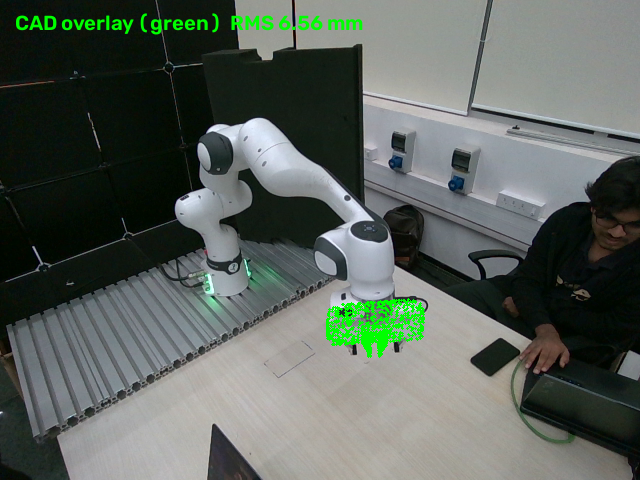

# Markerless Hand-Eye Calibration

**Eye-to-hand camera calibration for the Franka FR3 using an Intel RealSense, with no checkerboard, no fiducials and no ROS.**


`calibrate.py` estimates **T_base_cam**, the pose of a fixed RealSense camera in the robot base frame. It places the **Franka Hand CAD model** with forward kinematics, then matches it to the gripper's **depth point cloud** across many arm poses using multi-pose, multi-start ICP.

<p align="center">
  
  <br><em>Result check: the Franka Hand CAD model (green), projected through the estimated camera pose (RMS 6.6 mm).</em>
</p>

```
joint angles ──FK──► flange pose ──► CAD hand points (base frame)   ┐
                                                                     ├─► multi-pose ICP ──► T_base_cam
RealSense depth ──► ROI around gripper ──► gripper points (camera)  ┘
```

## Features

- **Markerless.** Uses the gripper itself as the calibration target, so nothing has to be mounted on the robot.
- **ROS-free.** A single Python file that runs on macOS or Linux. Joint angles can be typed in by hand.
- **Capture and solve run separately.** Capture runs live on the camera. The solver runs offline on saved `.npz` files and needs no hardware.
- **Robust solver.** Table-plane RANSAC, statistical outlier removal, a coarse-to-fine correspondence radius, and multi-start search to avoid local minima.
- **Built-in checks.** Per-pose fit statistics, CAD overlay images, an automatic `UNRELIABLE` flag, and a synthetic self-test.
- **Extensible.** Franka FR3 forward kinematics are built in. Other arms plug in through a small `flange_pose()` interface.

## Contents

| Path | Description |
|---|---|
| `calibrate.py` | The tool. Subcommands: `capture`, `solve`, `selftest`, `franka-fk` |
| `hand.stl`, `finger_0.obj` | Franka Hand meshes in metres, from [MuJoCo Menagerie](https://github.com/google-deepmind/mujoco_menagerie/tree/main/franka_emika_panda) (Apache-2.0) |
| `poses/pose_XXX.npz` | Captured poses: colour image, averaged depth, intrinsics `K`, ROI, flange pose, joints |
| `hand_eye.yaml` | Calibration result written by `solve` |
| `overlays/*_overlay.png` | Visual check written by `solve`: the CAD model drawn in green over each image |

## Installation

```bash
git clone https://github.com/geekcoder01/markerless-hand-eye-calibration.git
cd markerless-hand-eye-calibration
python3 -m venv .venv
source .venv/bin/activate
pip install -r requirements.txt
```

### pyrealsense2

`pyrealsense2` is needed **only for `capture`**.

- **Linux / Windows:** `pip install pyrealsense2`
- **macOS:** there is no official wheel. Build [librealsense](https://github.com/IntelRealSense/librealsense) from source with the RSUSB backend (`-DFORCE_RSUSB_BACKEND=ON -DBUILD_PYTHON_BINDINGS=ON`). Then put the build folder on `PYTHONPATH`, or add a `.pth` file to the venv, and set `DYLD_LIBRARY_PATH`:

  ```bash
  export DYLD_LIBRARY_PATH=$HOME/librealsense/build/Release
  ```

  macOS needs root for USB access to the camera, and `sudo` drops `DYLD_LIBRARY_PATH`. This helper passes it through:

  ```bash
  rspy() { sudo -E env DYLD_LIBRARY_PATH="$DYLD_LIBRARY_PATH" "$VIRTUAL_ENV/bin/python" "$@"; }
  ```

`solve`, `selftest` and `franka-fk` never touch the camera, so they don't need `sudo` or `pyrealsense2`.

## Quick start

```bash
# 1. Verify the solver on synthetic data (no hardware)
python calibrate.py selftest

# 2. Calibrate from the included sample poses
python calibrate.py solve --pose-dir poses --cad franka-hand \
    --cad-file hand.stl --finger-mesh finger_0.obj
```

The self-test should recover the synthetic camera pose to within about 0.05° and 1 mm.

## Workflow

### 1. Check forward kinematics

```bash
python calibrate.py franka-fk --q "0 -0.785 0 -2.356 0 1.571 0.785"
```

Compare the output with the flange pose the robot reports for the same joint angles (`O_T_F`).

### 2. Capture poses

```bash
rspy calibrate.py capture --arm franka --out-dir poses     # add --deg for degrees
```

For each pose:

1. Move the arm. Keep the gripper **closed** and wait until the arm is still.
2. Read the 7 arm joint positions, for example with `ros2 topic echo /joint_states --once` on the robot PC. Leave out the finger joints.
3. Click the camera window and press **`c`**.
4. Paste the 7 numbers into the terminal. Brackets and commas are fine. Check that the printed flange position looks right.
5. Drag a box around **only the gripper**, then press **Space/Enter**. Press `c` to cancel.
6. Don't move the arm until `saved poses/pose_XXX.npz` is printed.

Press **`q`** in the camera window to quit. Avoid Ctrl-C, because it can leave the camera claimed. Pose numbering continues across sessions.

**Pose guidelines (12–20 poses):**

- Keep the gripper 0.4–0.9 m from the camera. Under about 0.3 m there is no depth.
- Spread the poses left/right, near/far and high/low.
- **Vary the orientation. This matters most:** tilt the hand ±30–45° in different directions and change the joint-7 angle.
- Show the broad side of the hand to the camera. It must not be hidden by the arm or touching the table.

### 3. Solve

```bash
python calibrate.py solve --pose-dir poses --cad franka-hand \
    --cad-file hand.stl --finger-mesh finger_0.obj
```

| Option | Purpose |
|---|---|
| `--init "x y z qx qy qz qw"` | Initial guess for T_base_cam |
| `--init-yaml hand_eye.yaml` | Warm start from a previous result |
| `--cad-scale 0.001` | For meshes in millimetres |
| `--starts N` | Number of random restarts in the multi-start search (default 30) |
| `--max-iter N` | Maximum ICP iterations (default 90) |
| `--out`, `--overlay-dir` | Output locations |

### 4. Validate

- **Terminal:** a line per pose with the share of gripper points explained and their mean error. A median above 60% means the result is plausible.
- **Overlays:** the green CAD points must sit on the gripper in **every** image.
- **Outliers:** if one pose is much worse than the rest, it usually has mistyped joints, a moved arm or a bad ROI. Delete that `pose_XXX.npz` and solve again.

If the fit is poor, the result is written to `hand_eye.yaml.UNRELIABLE` instead of `hand_eye.yaml`.

## Output

```yaml
parent_frame: base_link
child_frame: camera_color_optical_frame   # x right, y down, z forward
translation: [x, y, z]                    # metres
rotation_xyzw: [qx, qy, qz, qw]
rms_error_mm: 6.56
median_explained_fraction: 0.721
n_board_poses: 10
method: cad_depth_icp_noros
```

To publish it as a static transform in ROS 2:

```bash
ros2 run tf2_ros static_transform_publisher \
  --x X --y Y --z Z --qx QX --qy QY --qz QZ --qw QW \
  --frame-id base_link --child-frame-id camera_color_optical_frame
```

## Method

1. **CAD model.** The hand mesh, plus both closed fingers if `--finger-mesh` is given, is sampled into 5000 surface points. It is then rotated −45° about z, because the Franka Hand frame is twisted relative to the flange.
2. **Observed points** (`extract_points`), per pose:
   - fit the table plane with RANSAC
   - back-project the depth pixels inside the ROI using the intrinsics
   - drop points within 25 mm of the table and points more than 10 cm from the median depth
   - remove statistical outliers and subsample to at most 1800 points
3. **Model points.** The CAD points are transformed by the forward-kinematics flange pose into the base frame.
4. **Initialization.** Use `--init` or `--init-yaml` if given. Otherwise, use Kabsch alignment of the per-pose centroids, which needs at least 4 poses.
5. **Multi-pose ICP.** A nearest-neighbour correspondence radius shrinks from 35 mm to 10 mm, and one rigid transform is solved for all poses together with Kabsch.
6. **Multi-start search.** ICP is restarted from 30 perturbed initial guesses (up to 25° and about 5 cm away). The best candidates are refined on the full point clouds, and the one that explains the most observed points is kept.
7. **Report.** Per-pose residuals, overlays, and the YAML result are written.

## Adding another robot

Write a class with `flange_pose() -> (p[3], R[3x3], joints[n])` and register it in `make_arm()` in `calibrate.py`. Then pass a CAD mesh expressed in the flange frame with `--cad file --cad-file your_tool.stl`.

## Troubleshooting

| Symptom | Cause / fix |
|---|---|
| `RuntimeError: No device connected` | Plug the camera straight into the computer with a USB-3 data cable. Check that it is visible with `ioreg -p IOUSB -l -w0 \| grep -i realsense` (macOS) or `lsusb` (Linux). A stale capture process may still hold the camera: `pgrep -fl calibrate.py`. |
| `ModuleNotFoundError: pyrealsense2` / library not loaded | The wrong venv is active, or `DYLD_LIBRARY_PATH` is not set (macOS). |
| Keys do nothing during capture | Click the camera window first. Keys go to the focused window. |
| `need exactly 7 joint angles, got N` | The finger joints were pasted too, or a value is missing. |
| `skip pose_XXX: too few valid gripper points` | The ROI missed the gripper, or the depth has holes (too close, or a shiny surface). Capture that pose again. |
| Overlay shifted in every image | Check the forward kinematics (`franka-fk`), the mesh scale, and that the gripper was closed. |
| Overlay good except in one image | That pose's joints were wrong or the arm moved. Delete it and solve again. |
| Output written as `.UNRELIABLE` | Most observed points weren't explained. Capture more varied poses, tighten the ROIs, or provide `--init`. |

## Acknowledgements

- Franka Hand meshes: [google-deepmind/mujoco_menagerie](https://github.com/google-deepmind/mujoco_menagerie), Apache License 2.0.
- [Intel RealSense SDK](https://github.com/IntelRealSense/librealsense).

## License

The code is released under the [MIT License](LICENSE). The bundled meshes keep their original Apache-2.0 license.
